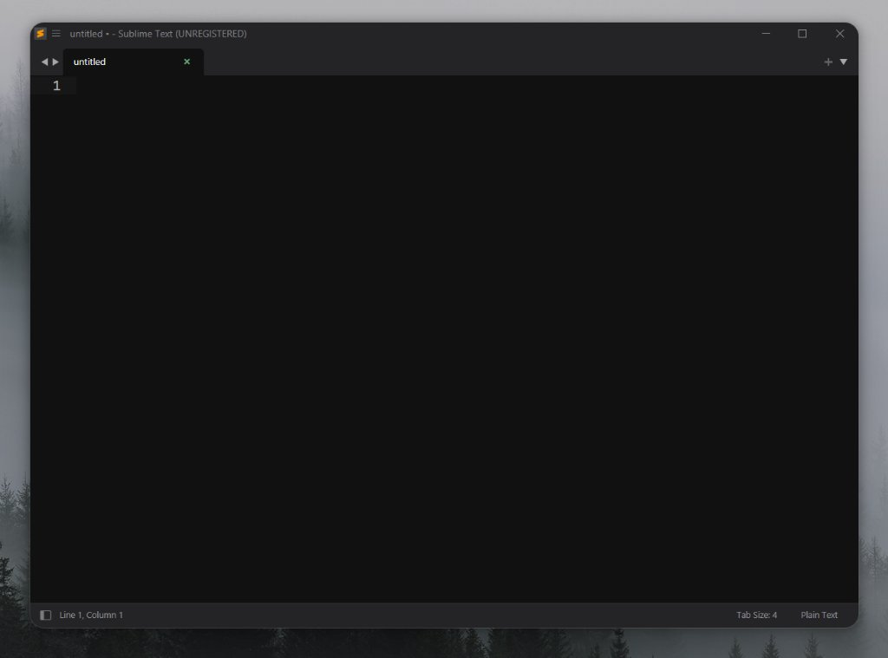

# subtext-ui-dark

Tema oscuro minimalista para **Sublime Text 4** inspirado en la interfaz de **Antigravity**.



## Características
- **Editor obsidian:** fondo principal `#111111` con resaltado de sintaxis balanceado.
- **Interfaz de alto contraste suave:** sidebar, barra superior, pestañas y barra de estado en `#242426`.
- **Pestaña activa redondeada:** esquinas superiores redondeadas con texturas 9-slice (`1x` y `@2x` HiDPI) integradas sin corte con el editor.
- **Instalación multiplataforma:** compatible con **Package Control (GitHub)**, archivo `.sublime-package` y scripts de instalación en 1 clic.

---

## Instalación

### Opción 1 — Vía Package Control (desde GitHub)
1. En Sublime Text abre la paleta de comandos (`Ctrl+Shift+P` / `Cmd+Shift+P`).
2. Ejecuta **`Package Control: Add Repository`** y pega la URL de este repositorio:
   ```text
   https://github.com/jdsgnrinfo/subtext-ui-dark
   ```
3. Ejecuta **`Package Control: Install Package`** y selecciona **`subtext-ui-dark`**.
4. Activa el tema en `Preferences` → `Settings` (ver configuración abajo).

### Opción 2 — Instalador automático (Windows / macOS / Linux)
- **Windows:** clona o descarga el repo y haz doble clic en **`install.bat`** (o ejecuta `.\install.ps1`).
- **macOS / Linux:**
  ```bash
  chmod +x install.sh
  ./install.sh
  ```

### Opción 3 — Manual (archivo `.sublime-package`)
1. Copia `dist/subtext-ui-dark.sublime-package` en la carpeta `Installed Packages` de Sublime Text:
   - **Windows:** `%APPDATA%\Sublime Text\Installed Packages\`
   - **macOS:** `~/Library/Application Support/Sublime Text/Installed Packages/`
   - **Linux:** `~/.config/sublime-text/Installed Packages/`
2. Añade a `Preferences` → `Settings`:
   ```json
   {
       "theme": "Antigravity.sublime-theme",
       "color_scheme": "Antigravity.sublime-color-scheme",
       "themed_title_bar": true,
       "overlay_scroll_bars": "enabled"
   }
   ```

---

## Desarrollo / Modificación
Si editas `Antigravity.sublime-theme`, `Antigravity.sublime-color-scheme` o los PNGs en `assets/`, regenera el paquete portable ejecutando:
```powershell
.\build.ps1
```
